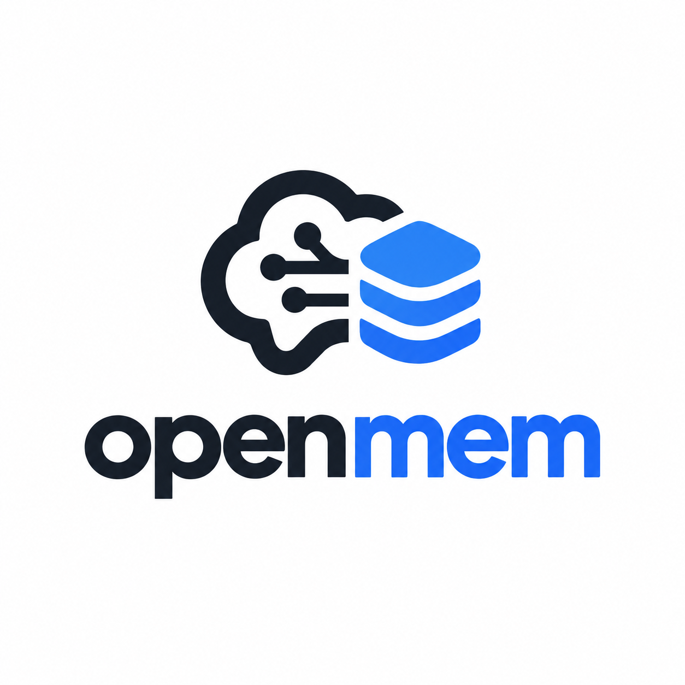

<p align="center">
  
</p>

# OpenMem

> Persistent, inspectable memory and smart context management for AI coding agents - delivered through GitHub Copilot hooks, MCP, and custom instructions.

[](LICENSE)
[](https://nodejs.org)

## What is openmem?

`openmem` gives AI coding agents **persistent memory** and **context compression** that survives across sessions. It works by hooking into the Copilot lifecycle - deterministically, without relying on the model to call a tool.

**Copilot-first.** The primary target is GitHub Copilot CLI and the Copilot cloud agent. The core is agent-agnostic, enabling thin adapters for Claude Code and others.

### Key differentiators vs. GitHub Copilot Memory

| Feature                         | GitHub Copilot Memory   | openmem                            |
| ------------------------------- | ----------------------- | ---------------------------------- |
| Storage                         | Cloud (GitHub)          | Local SQLite + Markdown            |
| Inspectable/editable by user    | Limited (GitHub.com UI) | Yes - plain Markdown, git-friendly |
| Works offline                   | No                      | Yes                                |
| Cross-tool (Claude Code, etc.)  | No                      | Yes (thin adapters)                |
| Tool-output compression         | No                      | Yes (`postToolUse`)                |
| Custom decay / retention policy | No                      | Yes                                |
| Open source                     | No                      | Yes                                |

### Differentiators

1. **Local-first and human-readable.** Storage is SQLite plus exportable Markdown. You can read, edit, and delete what the agent "remembers".
2. **Deterministic via hooks.** Recall and capture do not depend on the model deciding to call a tool.
3. **Context relief at the source.** Large tool outputs are compressed and offloaded using `postToolUse` result modification.
4. **Real forgetting.** Time decay, importance, supersession of contradicted facts, and capacity limits.
5. **One-command setup.** `openmem init` wires hooks + MCP + instructions into a repo.

## Quick Start (60 seconds)

```bash
# Install globally
npm install -g openmem-cli

# Wire into your repo (adds hooks, MCP registration, instructions)
cd your-repo
openmem init

# Check everything is working
openmem doctor

# Add a memory manually
openmem add "This project uses pnpm workspaces; never use npm."

# Recall memories matching a query
openmem recall "package manager"
```

After `init`, every Copilot CLI session will automatically:

- **Inject** relevant memories at session start
- **Compress** large tool outputs and store refs
- **Prompt** you (via `agentStop`) to save new learnings

## How It Works

```
sessionStart ─► hook ─► recall memories ─► inject into context
postToolUse  ─► hook ─► compress large outputs ─► store ref, return stub
agentStop    ─► hook ─► ask agent to save learnings (once per turn)
sessionEnd   ─► hook ─► consolidate, decay, export
MCP tools    ─► memory_remember / memory_recall / memory_forget / read_ref
```

See [docs/how-it-works.md](docs/how-it-works.md) for the full lifecycle diagram.

## Privacy

- Everything stays on your machine by default.
- Secrets/PII are scrubbed before storage.
- `.env*`, `*.pem`, private keys are never stored.
- `openmem forget --all` works offline, always.

See [docs/privacy.md](docs/privacy.md) for full details.

## CLI Reference

```
openmem init [--cli] [--cloud-agent] [--global] [--yes] [--bin PATH]
openmem doctor
openmem add "text" [--kind semantic|episodic|procedural] [--importance 0.8] [--pin]
openmem recall "query" [-k 5]
openmem list [--history] [--kind semantic|episodic|procedural]
openmem forget <id>|--all
openmem export [--out .github/openmem/memories.md]
openmem import <file>
openmem explain [--session <id>]
openmem stats
openmem hook <event>   # internal; reads JSON on stdin
openmem mcp            # start MCP server
```

## Packages

| Package                 | Description                                                                 |
| ----------------------- | --------------------------------------------------------------------------- |
| `openmem-core`         | Agent-agnostic library: store, memory, retrieval, policies, context, export |
| `openmem-hooks`        | Hook handlers + payload normalizer                                          |
| `openmem-mcp`          | MCP server (stdio)                                                          |
| `openmem-cli`       | The `openmem` binary                                                        |
| `openmem-instructions` | Generators for Copilot instruction files                                    |
| `openmem-plugin`       | GitHub Copilot CLI plugin bundle (manifest, hooks, MCP, instructions)       |

## Documentation

- [How it Works](docs/how-it-works.md) - Architecture lifecycle and compression flow
- [Copilot Platform Notes](docs/copilot-platform-notes.md) - Verified platform facts and runtime specifics
- [Privacy & Security](docs/privacy.md) - Redaction patterns and offline guarantees
- [Benchmarks](docs/benchmark.md) - Latency and compression performance
- [Architecture Decisions (ADR)](docs/decisions/0001-runtime.md) - Runtime choice and SQLite strategy
- [Risks & Open Questions](docs/open-questions.md) - Technical risks and mitigation strategies

## Development

```bash
pnpm install
pnpm build
pnpm test
pnpm lint
```

## License

MIT - see [LICENSE](LICENSE).
